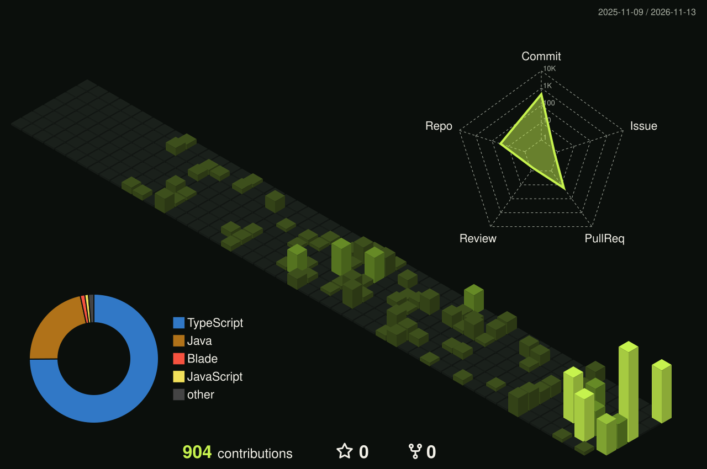

  

 

Sou o Gustavo, desenvolvedor full-stack de Palmas, no Tocantins. Programo desde os 16 e hoje cuido de sistemas do começo ao fim: modelagem do banco, API, autenticação, testes, interface e deploy.

No back-end trabalho com **Java (Quarkus e Spring Boot)** e Node.js. No front, **React com TypeScript**, e no mobile, **React Native com Expo**. Desde 2024 toco a **Gustavo Dev**, onde faço sites e sistemas para clientes reais, e no LinkedIn escrevo sobre JVM e performance com benchmark próprio.

Quando o projeto pede site, ele não sai de template. Mas o que eu mais gosto de construir é o que fica por trás da tela.

 

Também por aqui: <a href="https://github.com/Gustavo16378/monte-vinhedo">monte-vinhedo</a> · <a href="https://github.com/Gustavo16378/notificacoes-api">notificacoes-api</a> · <a href="https://github.com/Gustavo16378/anonimizador-pdf">anonimizador-pdf</a> · <a href="https://github.com/Gustavo16378/freelancer-desk">freelancer-desk</a> · <a href="https://github.com/Gustavo16378/autoria">autoria</a> · <a href="https://github.com/Gustavo16378/torra-cardapio">torra-cardapio</a>

<table align="center">
  <tr>
    <td align="right"><b>BACK-END</b></td>
    <td>
      
      
      
      
      
    </td>
  </tr>
  <tr>
    <td align="right"><b>FRONT-END</b></td>
    <td>
      
      
      
      
      
      
    </td>
  </tr>
  <tr>
    <td align="right"><b>MOBILE</b></td>
    <td>
      
      
    </td>
  </tr>
  <tr>
    <td align="right"><b>DADOS</b></td>
    <td>
      
      
      
      
      
    </td>
  </tr>
  <tr>
    <td align="right"><b>INFRA</b></td>
    <td>
      
      
      
      
      
    </td>
  </tr>
  <tr>
    <td align="right"><b>QUALIDADE</b></td>
    <td>
      
      
      
      
      
    </td>
  </tr>
  <tr>
    <td align="right"><b>IA</b></td>
    <td>
      
      
    </td>
  </tr>
</table>

  

  

Palmas, TO · <a href="https://gustavodev.dev">gustavodev.dev</a>

